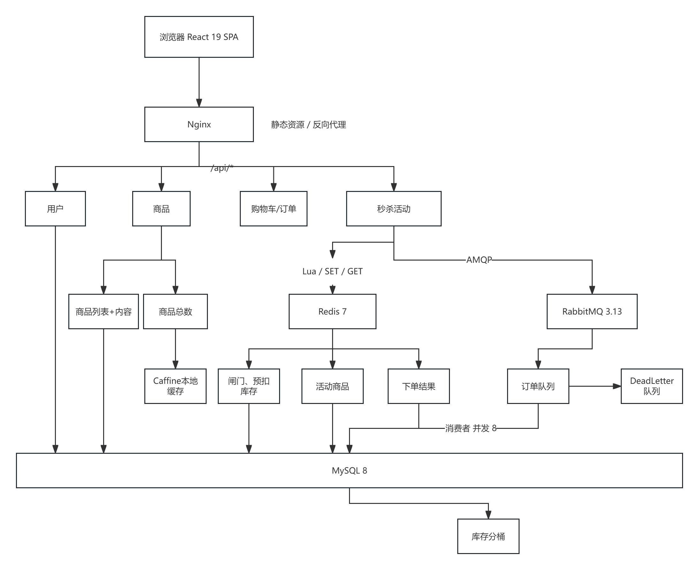
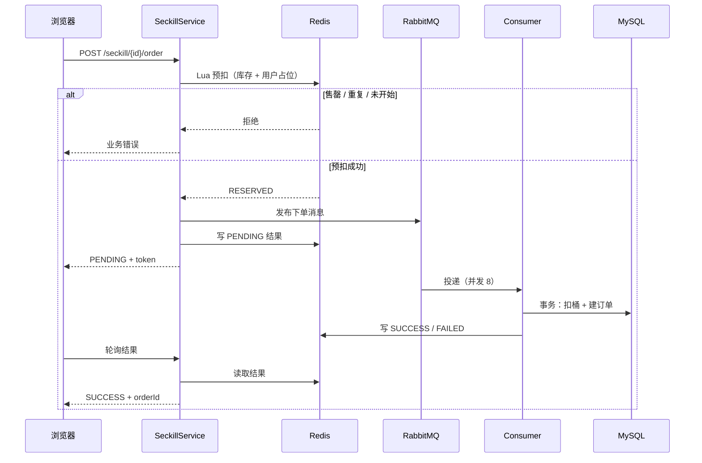

# DoroShop

一个前后端分离的商城 + 秒杀项目。重点不是功能数量，而是完整走一遍
**单体开发 → 部署 → 压测暴露瓶颈 → 针对性改造 → 再压测对比** 的过程，
每一轮改造都有基线数据和复盘文档。

- 后端：Java 25 / Spring Boot 4.1.1 / MyBatis-Plus / MySQL 8
- 中间件：Redis（Lua 闸门）、RabbitMQ（异步下单）、Caffeine（本地缓存）
- 前端：React 19 / TypeScript / Vite / Ant Design
- 部署：Nginx + Docker Compose，应用与压测各一台 2C4G ECS



四个业务模块（用户、商品、购物车/订单、秒杀）运行在**同一个 Spring Boot 进程**内，通过 Nginx 统一入口；
Redis 与 RabbitMQ 只服务于秒杀域，其他模块直接读写 MySQL。

## 功能

| 模块 | 内容 |
|---|---|
| 用户 | 注册、登录（JWT）、账户中心、修改密码、地址簿 |
| 商品 | 分类、SPU/SKU 列表与详情、关键字搜索（LIKE 基线） |
| 购物车 | 增删改、勾选、库存校验 |
| 订单 | 购物车/立即购买下单、支付（模拟）、取消、超时自动取消与库存回滚 |
| 秒杀 | 活动列表/详情、Redis 闸门、同步或异步下单、下单结果轮询、限购与幂等 |

未实现：管理端、发货/收货、真实支付、退款、优惠券。

## 技术栈

| 层 | 选型 |
|---|---|
| 后端 | JDK 25、Spring Boot 4.1.1（MVC + Security + OAuth2 Resource Server）、MyBatis-Plus 3.5.18 |
| 数据 | MySQL 8（RDS）、Redis 7（String + Lua + Set）、Caffeine |
| 消息 | RabbitMQ 3.13（主队列 + 死信队列） |
| 前端 | React 19、TypeScript 6、Vite 8、Ant Design 6、React Router 7 |
| 接口契约 | OpenAPI 3（`api/openapi.yaml`），前端类型由 `openapi-typescript` 生成 |
| 部署 | Nginx、Docker Compose、ECS + RDS |

## 架构

```
浏览器 → Nginx（静态资源 + /api 反代）
           ├── backend :8080（Spring Boot，单实例）
           ├── redis   :6379（秒杀闸门，不持久化，重启从 DB 重建）
           └── rabbitmq:5672（秒杀下单队列 + DLQ）
                     │
                     └── RDS MySQL（doro_mall）
```

## 压测驱动的三次演进

测量环境：应用 ECS 2C4G + RDS，JMeter 独立 2C4G；关闭 JFR/GC 日志；预热约 18 分钟。
S4 的 burst 窗口定义为测试开始后的前 15 秒。

| 轮次 | 改动 | 关键结果 |
|---|---|---|
| 2026-11-04 | 基线（无 Redis） | S0 商品列表 432 QPS / p99 244ms；S2 300/500 线程出现 64/128 个 HTTP 500（Hikari 打满）；S4 突发期冷请求 p99 劣化到 6.4 / 8.2s |
| 2026-11-05 | Redis Lua 闸门 | 超额认购有效：S4b 突发冷 p99 0.66 / 1.01s；全赢仍打满 Hikari（S2-500 98 个 500），S4c 冷 p99 5.9 / 7.0s |
| 2026-11-06 | RabbitMQ 异步下单 + 8 桶库存 | **S2/S4c 的 HTTP 500 归零**；S4c 突发冷 p99 0.71 / 1.20s；S2-500 受理延迟 6.29s → 1.74s |

结论：

- **闸门只在“请求远大于库存”时有效**：输家被 Redis 拦住，不再占用 DB 连接；
- **全赢场景必须异步化**：每个请求都要写库，只能把突发从请求路径移走；
- **分桶解决单行锁**：500 单并行落在 8 行，S4c 采样时 MySQL 行锁等待峰值为 1；
- **异步只移走 DB 事务，不移走 HTTP 成本**：500 并发在 2C 上受理延迟仍有 2.2s。

完整数字与复盘：`HANDOFF.md` 第 4.5 / 4.6 节、`DECISIONS.md` 第 7 / 11 节。

## 秒杀链路

```
POST /seckill/{id}/order
  → 活动校验
  → Redis Lua：库存 -1 + 用户占位（原子；返回 售罄/重复/未开始/已结束/成功）
  → 同步模式：直接进入 DB 事务
  → 异步模式：发 RabbitMQ → Redis 写 PENDING → 返回 token
                  ↓ 消费者（并发 8）
           校验地址/活动/商品 → 事务：扣桶 + 建订单/明细/地址快照
           → 结果写 SUCCESS/FAILED → ack
GET /seckill/order/result?token=   ← 前端轮询
```



关键设计：

1. **Redis 只做准入，DB 才是真相**：Lua 预扣通过后才进事务，事务内仍有条件扣减与唯一键兜底，Redis 挂了返回 503，不降级 DB。
2. **幂等三层**：Redis 用户占位、`orders` 的 `uk_activity_user`、异步令牌 `order_token` 唯一索引；消息重投直接返回成功。
3. **失败回滚**：入队失败回滚预扣并返回 503；地址/商品等永久失败回滚预扣并写 FAILED；DB 暂时异常交给 MQ 重试（3 次后进 DLQ）。
4. **库存分桶**：活动库存拆成 8 行，随机起始桶 + 线性探测；取消/超时按订单记录的桶号回补；活动行的 `available_stock` 降级为展示缓存，由对账任务每 5 分钟刷新。
5. **超时取消**：定时扫描 + 条件更新（`status=0 AND expire_time<NOW()`），与支付在同一行锁上互斥，库存只回补一次。

## 快速开始

前置：JDK 25、Maven 3.9、Node 20+、MySQL 8、Redis 7；（异步秒杀需要）RabbitMQ 3.13。

```bash
# 1. 初始化数据库
mysql -h <host> -u <user> -p -e "CREATE DATABASE doro_mall DEFAULT CHARSET utf8mb4"
mysql -h <host> -u <user> -p doro_mall < Shop/sql/schema.sql
mysql -h <host> -u <user> -p doro_mall < Shop/sql/data.sql
# 已有库按需执行迁移
mysql -h <host> -u <user> -p doro_mall < Shop/sql/migration_2026-11-03_seckill.sql
mysql -h <host> -u <user> -p doro_mall < Shop/sql/migration_2026-11-06_seckill_async.sql
mysql -h <host> -u <user> -p doro_mall < Shop/sql/migration_2026-11-06_seckill_bucket.sql

# 2. 中间件
docker run -d --name doroshop-redis -p 6379:6379 redis:7-alpine \
  redis-server --save "" --appendonly no --maxmemory-policy noeviction
docker run -d --name doroshop-rabbitmq -p 5672:5672 \
  -v doroshop-rabbit-data:/var/lib/rabbitmq \
  -e RABBITMQ_DEFAULT_USER=doroshop -e RABBITMQ_DEFAULT_PASS=<password> \
  rabbitmq:3.13-management-alpine

# 3. 本地配置（已被 gitignore，不会入库）
cp Shop/src/main/resources/application-local.example.yaml \
   Shop/src/main/resources/application-local.yaml
# 填入数据库账号密码

# 4. 启动后端（默认 local,dev profile）
cd Shop && mvn spring-boot:run

# 5. 启动前端（默认代理 /api 到 localhost:8080）
cd shop-web && npm install && npm run dev
```

异步秒杀默认关闭；需要时用环境变量打开：

```bash
SHOP_SECKILL_ASYNC_ENABLED=true \
RABBITMQ_HOST=localhost RABBITMQ_USERNAME=doroshop RABBITMQ_PASSWORD=<password> \
mvn spring-boot:run
```

## 测试

```bash
cd Shop && mvn test
```

- 95 个测试：服务层、并发、Controller 集成
- 需要本地 MySQL `doro_mall_test` 与 Redis（测试使用 DB 1）；`application-test.yaml` 已隔离库与连接池
- 并发用例覆盖：超卖、同用户并发、重复提交、取消回补、Redis 不可用 503、异步重投幂等

## 压测

压测脚本与运行手册在 `deploy/loadtest/`，JMeter 计划在 `deploy/jmeter/`：

- `doroshop.jmx` 商品列表、`cold-browse.jmx` 冷请求、`seckill-burst.jmx` 秒杀突发、`mixed.jmx` 混合场景
- `sample-mysql.sh` / `sample-app.sh` / `sample-nginx.sh` 三类采样
- `archive-results.sh` 按 `日期_git版本` 归档 JTL/HTML 并生成 MANIFEST

## 部署

见 [`deploy/README.md`](deploy/README.md)：`.env` 注入数据库、JWT、Redis、RabbitMQ 配置，
`docker compose up -d` 启动 backend / redis / rabbitmq / nginx。仓库内不包含任何真实地址或密码。

## 目录结构

```
Shop/                     后端（Maven）
  src/main/java/...        controller / service / mapper / task / support
  src/test/java/...        95 个测试
  sql/                     schema、数据、增量迁移
shop-web/                 前端（React + TS + Vite）
api/openapi.yaml          接口契约（前端类型由此生成）
deploy/                   部署与压测脚本
BLUEPRINT.md              项目蓝图与阶段规划
DECISIONS.md              技术决策与取舍（改表/改架构前必读）
HANDOFF.md                当前进度、压测结果、已知问题
```

## 已知限制

- 秒杀异步链路还缺：publisher confirm、DLQ 消息的预扣对账、RabbitMQ 数据卷持久化
- 无管理端、无发货/收货、支付为模拟；普通订单提交幂等未做
- 未做限流/防刷、JWT 吊销；搜索为 LIKE，商品量大时需升级 FULLTEXT 或 ES
- 单实例部署：JVM 本地锁、`@Scheduled` 任务在扩容前需要替换为分布式方案
- 无监控告警与 CI；前端包体约 1MB，尚未做代码分割

## 文档

- [`BLUEPRINT.md`](BLUEPRINT.md)：项目蓝图与演进路线
- [`DECISIONS.md`](DECISIONS.md)：技术选型、压测结论、Redis/MQ/分桶的设计决策
- [`HANDOFF.md`](HANDOFF.md)：当前状态、压测数据、下一步
- [`api/openapi.yaml`](api/openapi.yaml)：REST 接口契约
- [`deploy/loadtest/README.md`](deploy/loadtest/README.md)：压测运行手册
